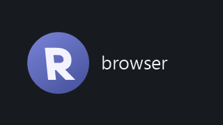

<p align="center"></p>

# Rbrowser

A minimal browser for Android TV / Google TV, built with .NET MAUI 10 and C#. Designed for a TV remote, with cursor mode enabled by default.

[Русский](README.ru.md)

## Features

- Graphite interface, Indigo icon, large controls and visible remote focus.
- Cursor and directional navigation; per-site desktop mode and a global desktop default.
- Editable favorites, tab cards, close-one / close-all, local session restore.
- Address editor and voice search using the device's speech recognition service.
- Russian and English interface; system language by default.
- Local browsing history, retention of 7 / 30 / 90 / 365 days; 30 days by default, 50 visits per page.
- Offline ad-filter snapshots from uBlock Origin uAssets, EasyList and RU AdList; manual updates and a global switch.
- Detection of accessible HLS, DASH, MP4 and WebM sources, an unobtrusive “Video found” card, native Media3 playback and an exit confirmation.

Rbrowser contains an independently written subset parser for static filters. It is **not the uBlock Origin extension**. Twitch ad removal is best effort. DRM and sources without an accessible media URL may need the website's player. No affiliation with the filter-list projects or streaming services is implied.

## Install the APK

Requires Android TV or Google TV with Android 8.0 or later and an ARM32 or ARM64 device.

Get `Rbrowser-0.8.2-tv.apk` from [GitHub Releases](https://github.com/Rif009/Rbrowser/releases) once the release is published. In the offline bundle, the APK is in the sibling `Release` folder.

**Install from a USB drive**

1. Copy the APK to a USB drive and plug it into the TV.
2. Open the APK with a file manager on the TV. If Android prompts you, allow that file manager to install apps from unknown sources.
3. Select **Install**, then open **Rbrowser** from **Apps**.

**Install over ADB**

1. Install [Android SDK Platform-Tools](https://developer.android.com/tools/releases/platform-tools) on your computer.
2. Enable debugging on the TV. For wireless debugging with a pairing code, use the pairing address shown on the TV with `adb pair TV_IP:PAIRING_PORT`.
3. Run these commands from the folder containing the APK. Replace `TV_IP:ADB_PORT` with the TV's ADB connection address. The pairing port and connection port can differ. Confirm any authorization prompt on the TV. [ADB connection guide](https://developer.android.com/tools/adb)

```powershell
adb connect TV_IP:ADB_PORT
adb devices
adb -s TV_IP:ADB_PORT install -r Rbrowser-0.8.2-tv.apk
```

An in-place update requires the same signing key. If Android reports `INSTALL_FAILED_UPDATE_INCOMPATIBLE`, use an APK signed with the key of the installed version. Uninstalling the existing app clears its local data.

In Rbrowser settings, **Set as default browser** opens Android's browser selection. Dedicated TV remote buttons may follow a manufacturer shortcut.

## Requirements

- Android TV / Google TV: Android 8.0 (API 26) or newer, ARM32 or ARM64.
- Development: Windows, .NET SDK 10.0.403, MAUI Android workload, JDK 21, Android SDK 36 / build-tools 36.0.0, Node.js 24+ and PowerShell 7.
- Updated Android System WebView. Voice search also needs a microphone / voice remote and a compatible speech recognition service.

## Build from source

```powershell
dotnet workload install maui-android
./tools/Publish.ps1
```

The script runs checks, prepares the bundled filter index and builds a universal APK:

`artifacts/Rbrowser-0.8.2-tv.apk`

The local build uses the machine's Android debug signing key. See [build and signing](docs/BUILDING.md) for release signing. APKs signed by different keys cannot update one another in place.

## Remote control

| Context | Controls |
| --- | --- |
| Interface | Arrows select; OK activates. |
| Cursor mode | Arrows move the pointer; OK clicks. Scroll near the top / bottom edge. |
| Page | Back opens the toolbar. First button collapses it, second opens detected videos, third toggles cursor mode. The address row edits the current URL. |
| Video discovery | A lavender notification explains how to open detected videos; the video button also turns lavender. |
| Native player | Arrows select real buttons; OK activates. Down selects the time bar, Up returns to playback. Menu opens speed / audio settings. |
| Exit player | Back asks for confirmation. Continue is focused first; dismissing the dialog resumes only previously playing media. |

## Checks

```powershell
dotnet run --project Rbrowser.Checks/Rbrowser.Checks.csproj -c Release
node tests/navigation.test.cjs
node tests/twitch-adblock.test.cjs
node tests/media-detector.test.cjs
node tests/localization.test.cjs
```

The workflow runs checks on pushes and pull requests. A manually started workflow also builds an Android APK artifact. It does not create a public release automatically.

## Project structure

| Path | Purpose |
| --- | --- |
| `Rbrowser` | MAUI host and Android-native TV interface / WebView / Media3 player |
| `Rbrowser.Core` | State, history retention, localization, media catalogue and filter parser |
| `Rbrowser.Checks`, `tests` | Core and JavaScript checks |
| `tools` | Filter preparation, banner generation, build helpers and optional local diagnostics |
| `THIRD_PARTY` | Sources, attribution and third-party license texts |

Browsing history, favorites and session metadata stay in the app's private local storage. Visited websites receive their normal requests; filter updates contact their official sources. Speech recognition is provided by the installed system service and may use its network service. See [privacy notes](docs/PRIVACY.md).

## License

Original Rbrowser code and artwork: [MIT](LICENSE). Bundled filter lists, prepared filter data and third-party components retain their own licenses; the MIT license does not replace those terms. See [THIRD_PARTY/NOTICE.md](THIRD_PARTY/NOTICE.md).

For publishing the repository and APK, see [PUBLISHING.md](PUBLISHING.md). For changes and device checks, see [CHANGELOG.md](CHANGELOG.md) and [testing notes](docs/TESTING.md).
