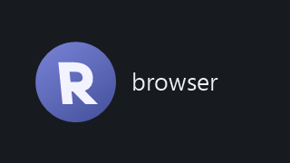

<p align="center"></p>

# Rbrowser

[English](README.md)

Браузер для Android TV и Google TV на .NET MAUI и C#. Интерфейс рассчитан на пульт. Курсор включён по умолчанию, избранное при первом запуске пустое.

## Возможности

- Управление курсором или стрелками пульта. Настройка ПК-версии сайтов глобально и для отдельных сайтов.
- Вкладки с восстановлением сеанса, редактируемое избранное и история с настраиваемым сроком хранения.
- Русский и английский интерфейс, голосовой поиск через системную службу распознавания речи.
- Блокировка рекламы с локальными списками uAssets, EasyList и RU AdList и ручным обновлением.
- Поиск доступных потоков HLS, DASH, MP4 и WebM, подсказка «Видео найдено» и встроенный плеер с подтверждением выхода.

Поддерживается часть статических правил фильтрации. Блокировка рекламы Twitch зависит от потока. Для DRM и видео без доступного прямого адреса может потребоваться плеер сайта.

## Установка APK

Нужен телевизор или приставка с Android TV или Google TV, Android 8.0 или новее и архитектурой ARM32 или ARM64.

После публикации скачайте `Rbrowser-0.8.2-tv.apk` в [GitHub Releases](https://github.com/Rif009/Rbrowser/releases). В офлайн-комплекте APK находится в соседней папке `Release`.

**Установка с флешки**

1. Скопируйте APK на USB-флешку и подключите её к телевизору.
2. Откройте APK в файловом менеджере на ТВ. Если Android запросит разрешение, разрешите этому менеджеру установку из неизвестных источников.
3. Нажмите **Установить** и запустите **Rbrowser** из списка приложений.

**Установка через ADB**

1. Установите [Android SDK Platform-Tools](https://developer.android.com/tools/releases/platform-tools) на компьютер.
2. Включите отладку на ТВ. Если телевизор предлагает сопряжение по коду, выполните `adb pair TV_IP:PAIRING_PORT`, подставив адрес из окна сопряжения.
3. Откройте терминал в папке с APK и выполните команды ниже. Вместо `TV_IP:ADB_PORT` подставьте адрес подключения ADB с телевизора. Порт подключения может отличаться от порта сопряжения. Подтвердите запрос отладки на ТВ, если он появится. [Руководство по ADB](https://developer.android.com/tools/adb)

```powershell
adb connect TV_IP:ADB_PORT
adb devices
adb -s TV_IP:ADB_PORT install -r Rbrowser-0.8.2-tv.apk
```

Для обновления поверх установленной версии нужен тот же ключ подписи. При ошибке `INSTALL_FAILED_UPDATE_INCOMPATIBLE` используйте APK с подписью установленной версии. Удаление приложения очищает его локальные данные.

Кнопка **Сделать браузером по умолчанию** в настройках Rbrowser открывает выбор браузера Android. Отдельная кнопка WEB на пульте может запускать приложение, заданное производителем ТВ.

## Управление с пульта

| Где | Действие |
| --- | --- |
| Интерфейс | Стрелки перемещают фокус, OK выбирает. |
| Курсор на сайте | Стрелки двигают курсор, OK нажимает. У верхнего или нижнего края страница прокручивается. |
| Страница | «Назад» открывает нижнюю панель. На ней можно изменить адрес, найти видео и переключить управление. |
| Встроенный плеер | Стрелки выбирают элементы, OK нажимает. Вниз переводит фокус на шкалу времени, вверх возвращает к воспроизведению. «Назад» открывает подтверждение выхода. |

## Сборка из исходников

Для сборки нужны Windows, .NET SDK 10.0.403, MAUI Android workload, JDK 21, Android SDK 36 с build-tools 36.0.0, Node.js 24+ и PowerShell 7.

```powershell
dotnet workload install maui-android
./tools/Publish.ps1
```

Готовый APK появится в `artifacts/Rbrowser-0.8.2-tv.apk`. Подробности о подписи и отправке файлов доступны в [инструкции сборки](docs/BUILDING.md) и [руководстве по публикации](PUBLISHING.md).

История, избранное и сведения о вкладках хранятся локально. [Политика конфиденциальности](docs/PRIVACY.md)

Исходный код и графика Rbrowser распространяются по [MIT](LICENSE). У сторонних компонентов и списков фильтрации действуют [собственные лицензии](THIRD_PARTY/NOTICE.md). [История версий](CHANGELOG.md)
